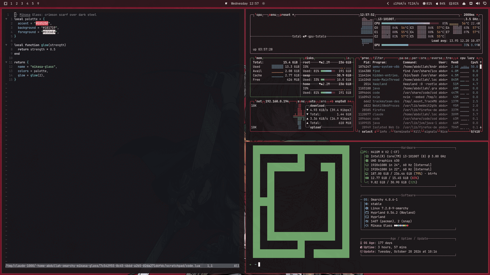

# Mikasa Glass

A dark frosted-glass theme for [Omarchy](https://omarchy.org), built around a crimson scarf, charcoal and steel.



Colors are generated into every Omarchy-themed app (terminal, Neovim, VS Code, btop, Walker, notifications, Quickshell, lock screen, browser) from `colors.toml`. Dark mode only.

## Install

```bash
omarchy-theme-install https://github.com/Abdullah-5603/omarchy-mikasa-theme
```

## What's included

| File | Purpose |
|---|---|
| `colors.toml` | The palette every app is generated from |
| `shell.toml` | Frosted-glass surfaces and alpha values for the Omarchy shell |
| `hyprland.lua` | Crimson window border |
| `icons.theme` | `Yaru-red` icon theme |
| `backgrounds/` | 6 wallpapers |
| `unlock.png`, `preview-unlock.png` | Lock screen logo and preview |
| `preview.png` | Theme picker preview |

## Glass effect and git install

`omarchy-theme-install` refuses to stage any `.lua` file from a git theme, so `hyprland.lua` (border color, window opacity) is ignored. The palette and the shell surfaces (bar, popups, notifications, menus at 0.88 alpha) still apply. For translucent windows without blur, add this to `~/.config/hypr/hyprland.lua`:

```lua
o.window({ tag = "default-opacity" }, { opacity = "0.88 0.88" })
```

Submitted to Omarchy as a built-in theme, `hyprland.lua` loads in full.

## Wallpapers

| # | File | Resolution | Size |
|---|---|---|---|
| 1 | [`mikasa-glass-wallpaper-1.jpg`](backgrounds/mikasa-glass-wallpaper-1.jpg) | 3840x2160 | 1.4 MB |
| 2 | [`mikasa-glass-wallpaper-2.jpg`](backgrounds/mikasa-glass-wallpaper-2.jpg) | 3840x2160 | 0.9 MB |
| 3 | [`mikasa-glass-wallpaper-3.jpg`](backgrounds/mikasa-glass-wallpaper-3.jpg) | 3840x2160 | 0.8 MB |
| 4 | [`mikasa-glass-wallpaper-4.jpg`](backgrounds/mikasa-glass-wallpaper-4.jpg) | 3840x2160 | 0.5 MB |
| 5 | [`mikasa-glass-wallpaper-5.jpg`](backgrounds/mikasa-glass-wallpaper-5.jpg) | 3840x2160 | 0.6 MB |
| 6 | [`mikasa-glass-wallpaper-6.jpg`](backgrounds/mikasa-glass-wallpaper-6.jpg) | 3840x2160 | 1.2 MB |

Upscaled to 4K with waifu2x.

## Palette

| Role | Hex |
|---|---|
| Accent (scarf crimson) | `#E0525F` |
| Background / dark / darker | `#1B1719` / `#121012` / `#0B0909` |
| Foreground | `#ECE6E4` |
| Danger red / success green / yellow | `#E0525F` / `#6FA36B` / `#E8C27A` |
| Blue / cyan / magenta | `#7FA3C7` / `#7FB5B0` / `#C9A6B4` |

## License

MIT, see `LICENSE`. Wallpapers are fan art of a character from *Attack on Titan*; the artwork belongs to its respective creators.
